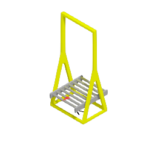

# Overhead Carrier
|||
|-|-|
|**Emulate3D Version**|19.00.01|
|**Tutorial Link**|https://store.sim3d.com/tutorials/how_to_skin_a_vehicle|
|||

## Description
This example provides a skinned AGV as an overhead carrier which:

- Picks up Loads from an incoming conveyor,
- Drops off Loads to an outgoing conveyor.

## Usage
- Open the Model.
- *Optional:* Upgrade Package scripts to the latest verion.
- Run the Model to see:
   - Loads beings picked up,
   - Loads being dropped off.
- *Optional:* Save the skinned overhead carrier to a custom catalog for use in other models. 