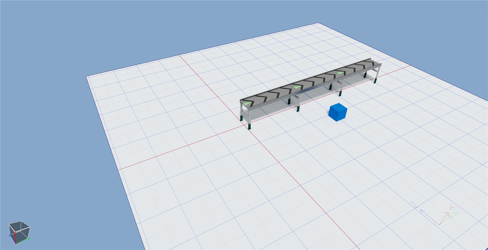

# Custom MCP Tools and Skills
|||
|-|-|
|**Emulate3D Version**|19.03.00|
|**Tutorial Link**|N/A|

## Description

This example shows how a model can extend the Emulate3D MCP server with its own tools and skills, so that an AI agent connected over MCP can work with the model in terms of its own domain. The model contains a line of three belt conveyors (`CV_01` to `CV_03`) and a `McpTools` visual that holds the [ConveyorLineMcp](custom_mcp_tools_and_skills.demo3dx/scripts/ConveyorLineMcp/ConveyorLineMcp.cs) C# project script.

### Custom tools

The `ConveyorLineTools` class is marked with `[McpServerToolType]` and inherits `McpToolBase`. Each method marked with `[McpServerTool]` becomes a tool, and its parameters and `[Description]` attributes become the tool's input schema. Every tool runs its work through `ExecuteMcpCommand`, which checks the MCP permission the tool needs before touching the model.

| Tool | Permission | Description |
|-|-|-|
| `GetLineStatus` | Allow Scene Read | Returns every conveyor in flow order with its length, motor state and speed. |
| `SetConveyorSpeed` | Allow Scene Modification | Sets one conveyor's motor speed, rejecting speeds outside 0 to 2 m/s. |
| `SetConveyorMotor` | Allow Scene Modification | Turns one conveyor's motor on or off. |

The tools return an `McpResult<T>`, which carries either a typed result or an error message back to the client.

### Custom skill

The `ConveyorLineSkills` class has a static method marked with `[McpSkillProvider]`. It returns the `Skills` folder next to the compiled script assembly. That folder holds one sub-folder per skill, and each sub-folder holds a `SKILL.md` with `name` and `description` front matter.

The [conveyor-line](custom_mcp_tools_and_skills.demo3dx/scripts/ConveyorLineMcp/Skills/conveyor-line/SKILL.md) skill tells the agent how the line is named and laid out, which of the custom tools to use, and the rules to follow when changing speeds. Its [LineLayout.md](custom_mcp_tools_and_skills.demo3dx/scripts/ConveyorLineMcp/Skills/conveyor-line/References/LineLayout.md) reference gives each conveyor's position, length and default speed.

The skill files are part of the script project. The [ConveyorLineMcp.csproj](custom_mcp_tools_and_skills.demo3dx/scripts/ConveyorLineMcp/ConveyorLineMcp.csproj) copies them to the build output with `CopyToOutputDirectory`, so they travel with the model. It also references the `ModelContextProtocol` 2.2.0 NuGet package, which provides the tool attributes.

## Usage

- Open the model in Emulate3D.
- Open the Web Configuration panel and, in the MCP server settings, enable **Allow Custom Tools** as well as **Allow Scene Read** and **Allow Scene Modification**.
- Start the server from the Web Configuration panel. If it was already running, restart it, because custom tools are only loaded when the server starts.
- Connect an MCP client, such as Claude Code or GitHub Copilot, to the server.
- Ask the agent to list the skills, and check that `conveyor-line` appears alongside the built-in skills.
- Ask the agent to read the `conveyor-line` skill and report the status of the line. It calls `GetLineStatus`.
- Ask the agent to speed the line up to 1 m/s. It calls `SetConveyorSpeed` for each conveyor, starting from `CV_03`, as the skill instructs.
- Ask the agent to stop the line, and watch the conveyor motors turn off in the scene.
