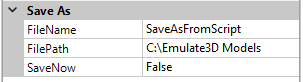

# Save As Via Script
|||
|-|-|
|**Emulate3D Version**|19.00.09|
|**Tutorial Link**|https://store.sim3d.com/demo3d_2026/model_save_as_via_script|
|||

## Description
This example performs a ‘Save As’ via script by:

- Overwriting the document Path,
- Performing a Save,
- Using custom properties.

## Usage
- Open the Model.
- Select the Box
- Input a file name on the FileName custom property.
- Input a file path on the FilePath custom property (optional).
- To run the Save function, either
   - Set the SaveNow custom property to True,
   - Run the Save As custom function on the Box.