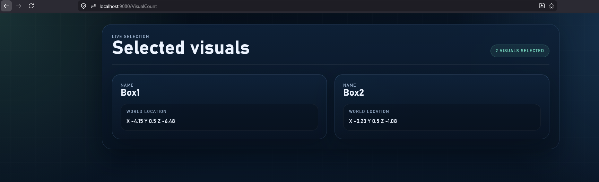

# Blazor Web Service
|||
|-|-|
|**Emulate3D Version**|19.01.00|
|**Tutorial Link**|N/A|

## Description

This example demonstrates how to host a Blazor Server web application inside Emulate3D using the `Emulate3D.WebApp` API. The model registers a web service via the `[Emulate3DWebService]` attribute in [MyService.cs](blazor-web-service.demo3dx/scripts/BoxScript/MyService.cs), which configures Razor components with interactive server-side rendering.

A [SelectedVisualService](blazor-web-service.demo3dx/scripts/BoxScript/SelectedVisualService.cs) tracks the current selection in the Emulate3D scene and notifies connected Blazor clients in real time. The [VisualCount.razor](blazor-web-service.demo3dx/scripts/BoxScript/Components/Pages/VisualCount.razor) page displays a live dashboard showing the name and world location of each selected visual.

## Usage

- Open the model in Emulate3D.
- Ensure that the 'My Service' web service is enabled from the Web Configuration panel.
- Start the server from within the Web Configuration Panel.
- Open a browser and navigate to the URL shown in the Web Configuration panel (e.g. `https://localhost:9080/VisualCount`).
- Select one or more visuals in the Emulate3D scene and move them around.
- Observe the Blazor dashboard update in real time to reflect the current selection.
