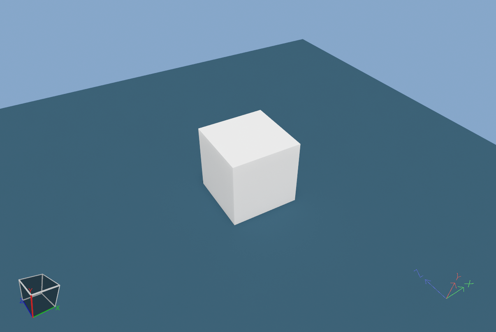

# Minimal API
|||
|-|-|
|**Emulate3D Version**|19.03.00|
|**Tutorial Link**|N/A|

## Description

This example demonstrates how to host an ASP.NET Core minimal API inside Emulate3D using the `Emulate3D.WebApp` API. The model registers a web service called 'My API Service' via the `[Emulate3DWebService]` attribute in [BoxScript.cs](minimal_api.demo3dx/scripts/BoxScript/BoxScript.cs).

The service's `Build` method uses `WithPostBuildAction` to map three HTTP GET endpoints that control the model:

| Endpoint | Action |
|-|-|
| `/api/start` | Starts the model running. |
| `/api/stop` | Stops the model. |
| `/api/reset` | Resets the model. |

The start and stop endpoints bind directly to `app.SceneAnimation.StartAsync` and `app.SceneAnimation.StopAsync`. The reset endpoint uses `app.BeginInvoke` to marshal the reset onto the Emulate3D UI thread.

## Usage

- Open the model in Emulate3D.
- Ensure that the 'My API Service' web service is enabled from the Web Configuration panel.
- Start the server from within the Web Configuration panel.
- Open a browser and navigate to the start endpoint using the URL shown in the Web Configuration panel (e.g. `https://localhost:9080/api/start`).
- Observe the model start running in Emulate3D.
- Navigate to `/api/stop` to stop the model, and `/api/reset` to reset it.
